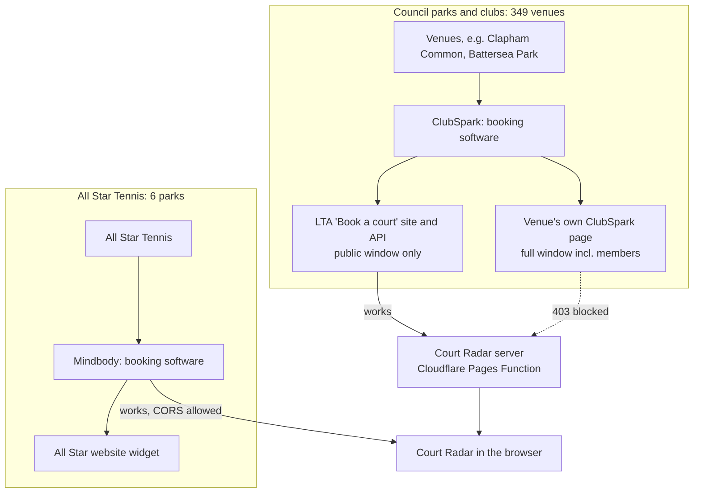
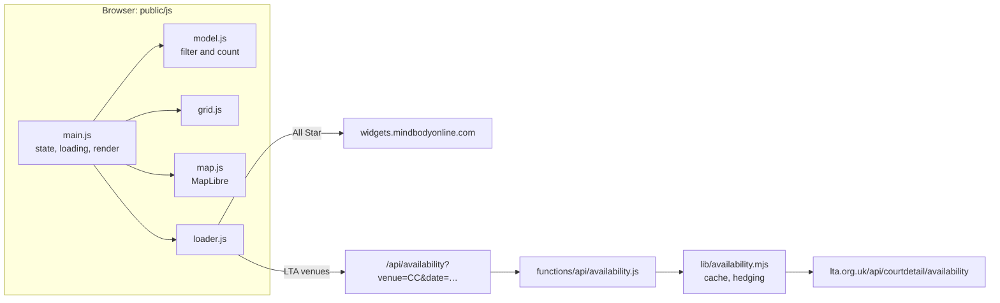

# Court Radar: notes for agents and maintainers

What the code doesn't tell you: how the booking systems behave, what was
tested and ruled out, how the venue lists were built, and the product rules the
owner has asked for. Findings are dated; booking systems change, so re-check
anything surprising.

## Product rules (from the owner)

- **Never show availability older than 60 seconds.** No stale fallback: if a
  source fails, show an error for that venue.
- **No timed background refresh.** Reload only on refresh, date or venue
  change, retry, or returning to the app after more than a minute.
- **New visitors start empty:** no venues, any time, any surface. Every change
  is remembered in `localStorage`.
- **Dense UI:** the grid is the point. Square cells with a dot, original palette
  (cream, dark green `#15372c`, lime `#d9ff5f`), light only. Prefer icons to
  text labels; no explanatory clutter in venue rows.
- **No "select all venues":** every venue is a separate upstream request.

## Who's who

- **ClubSpark** is the booking software most council park courts and clubs use.
  Each venue has a page such as
  `clubspark.lta.org.uk/BatterseaParkTennisCourts/Booking/BookByDate`.
- **LTA** (Lawn Tennis Association) runs "Book a court" on lta.org.uk. It holds
  no bookings itself: it fronts ClubSpark venues (its slot IDs are
  `clubspark.lta.org.uk/slots/...` URLs) and shows the **public** window.
- **All Star Tennis** is a separate operator using **Mindbody**.

## Architecture

- `public/shared/` is imported by both the browser and the server: venue list
  (`venues.js`, generated `lta-venues.js`), dates, and one adapter per source
  (`mindbody.js`, `lta.js`) that turns raw responses into
  `{ status, courts, slots, … }`.
- `lib/availability.mjs` serves one venue for one date per request. The Pages
  Function wraps it with Cloudflare's Cache API; `server.js` (local) uses
  memory.
- One request per selected venue, so the grid fills in as answers arrive and
  unselected venues cost nothing.
- Pure modules with tests: `model.js` (grid model), `prefs.js` (URL and
  storage), the adapters, and `lib/availability.mjs`.

## Data sources (findings as of 2026-11-01)

| | LTA feed | ClubSpark direct | Mindbody (All Star) |
|---|---|---|---|
| Endpoint | `GET https://www.lta.org.uk/api/courtdetail/availability?venueid=<uuid>&date=YYYY-MM-DD` | `GET https://clubspark.lta.org.uk/v0/VenueBooking/<Slug>/GetVenueSessions?resourceID=&startDate=…&endDate=…&roleId=` | `GET https://widgets.mindbodyonline.com/widgets/appointments/<widget>/results.json?…` |
| From Cloudflare | Works | **403 block page in ~3 ms, every time** | Not used server-side |
| From a browser | Not used (no CORS checked) | **Blocked: no CORS headers** | Works (CORS allowed) |
| From a home connection | Works | Works, fast (0.1–0.8 s) | Works |
| Window | Venue's **public** window | Full window incl. members | 2 days public, 14 Member Plus |
| Speed | 2–4 s, sometimes 30 s+ | Fast | ~0.5 s |

### LTA feed

- Response: `venueDetails[]` (courts with `id`, `name`, `order`, `surface`,
  `availableSlots[]` of `startTime`/`endTime`/`price`), `rules`
  (`availableDates[]`, `outsideBookingWindow`, `openingTime`, `closingTime`),
  `error.hasError`.
- `rules.availableDates` lists the dates the **public** can book now. Its
  latest date gives the window length. Windows differ by venue (on 2026-11-01:
  Clapham Common 7 dates, Brockwell Park 6 starting tomorrow, Battersea Park 2).
  A date past the window comes back with `outsideBookingWindow: true` and no
  courts; the app shows "Public booking opens …".
- A date inside the window but missing from `availableDates` (e.g. no same-day
  online booking) is shown as "Not bookable online for this date".
- Venues without public booking return `venueDetails: null`,
  `error.hasError: true`, empty message (e.g. The Spencer LTC). The finder
  script drops these.
- Surfaces include `Hard`, `Tarmac` (shown as hard), `Carpet`,
  `Artificial Grass`. Some venues list padel or pickleball courts (e.g. BEST's
  "Padel (lit 5pm>)"); `lta.js` filters names matching `padel|pickleball`.
- Court names vary wildly ("Tennis 1 (lit 5pm>)"); the grid shows the first
  number in the name.
- Latency tail: in one test, 1 of 18 parallel requests took 30 s. The server
  sends a second request if the first hasn't answered in 6 s and uses whichever
  answers first (`hedged()` in `lib/availability.mjs`), with a 20 s cap.
- Booking links can't deep-link to a slot; they open the venue page with
  `?date=`.

### ClubSpark direct: ruled out

- Gives everything LTA does plus the members' window (Battersea showed 55 open
  court-hours on a date LTA said wasn't open).
- Tested from Cloudflare on 2026-11-01 with a temporary endpoint uploaded as a
  preview deployment: 5 venues × with/without `Referer` × 3 runs = 30 requests,
  all `403` with an HTML block page in 2–6 ms. It's ClubSpark's own Cloudflare
  front door refusing Cloudflare Workers traffic. Rate limiting isn't the
  issue; retrying won't help.
- No `Access-Control-Allow-Origin`, so browsers can't read it either.
- The only way to use it would be a fetcher hosted outside Cloudflare, which
  ClubSpark could block too. The pre-rebuild app hit the same wall and offered
  a copy-and-paste JSON import for Battersea, since removed.

### Mindbody (All Star)

- The All Star court-hire page embeds Mindbody appointment widgets. The
  response is JSONP-ish (`({"contents": "<html>"});`) wrapping HTML with one
  `div.healcode-trainer` per court. The court ID is the `trainer-<id>` class
  (Mindbody "staff" ID). Each bookable slot is
  `a.hc-button.filterable[data-url]` with the time as text.
- Two widgets: `ce84117c767` (public, today to +2 days) and `ce84234c767`
  (Member Plus, +3 to +14 days). Beyond 14 days the app doesn't fetch.
- Booking links go to `cart.mindbodyonline.com/sites/99207/...` and work
  as-is.
- The feed has no prices. They're hard-coded in `venues.js` from All Star's
  published bands (peak = weekends or from 16:00; Furzedown is cheaper; King
  George's floodlit note). Update by hand if All Star changes prices.

## How the venue lists were built

### LTA venues (`scripts/find-lta-venues.mjs` → `public/shared/lta-venues.js`)

1. LTA's court search is a server-rendered page:
   `https://www.lta.org.uk/play/book-a-tennis-court/?latitude=…&longitude=…&location=…`.
   It returns about 30 nearest venues, 10 per page, with a `next page` link
   (`&p=2`). Each card links to `/play/book-a-tennis-court/courts/<slug>_<uuid>/`
   and shows the postcode. The uuid is the `venueid` for the feed. (The JS
   bundle's `/api/yourcourts/mynearbyvenuelist` is for signed-in users and
   returns nothing useful.)
2. The script searches from a grid of points ~4 km apart over Greater London
   (lat 51.29–51.69, lng −0.51–0.33; 180 points), following pagination.
3. Coordinates come from each venue page's Google Maps link
   (`51.47…%2C-0.13…`).
4. Each venue is kept only if the availability feed answers without
   `error.hasError`.
5. Codes: existing codes in the output file are preserved (they're used in URLs
   and saved preferences). New venues get initials-based codes, deduplicated,
   assigned in name order.

The 2026-11-01 run found 349 venues. It takes about 20 minutes; requests run 3–4
at a time with small pauses to stay polite to LTA.

Hand-written overrides live in `venues.js` (`LTA_OVERRIDES`): Battersea's
display name, its rules text, and its ClubSpark guest booking link
(`#?date=…&role=guest`).

### All Star venues (hand-written in `venues.js`)

These predate the rebuild and were found by inspecting the All Star court-hire
page's network requests. Per venue you need:

- `locationId`: `options[location_id]` in the widget request.
- `publicSession` and `memberSession`: `options[session_type_ids]` for the
  public and Member Plus widgets.
- Courts: the `trainer-<id>` values from the widget HTML, with names and
  surfaces. The full list matters, because the feed only includes courts that
  have a free slot.
- Coordinates: from a map.

To add or verify an All Star venue, open the court-hire page with devtools on
the Network tab and filter for `results.json`.

## Freshness and caching

- Server: each `venue/date` answer is cached for 60 s, in the isolate's memory
  and Cloudflare's Cache API (`functions/api/availability.js`). Concurrent
  requests for the same key share one upstream call. Failures are never cached
  and never fall back to older data.
- Browser: a result is reused only while `fetchedAt` (when the upstream
  answered) is under 60 s old (`loader.js`), so server and browser caching
  together never exceed a minute.
- Responses to the browser are `cache-control: no-store`.

## Front end

- Layout: a top bar (filters toggle, grid/map, status, refresh, share), a date
  bar (today to +14 days), and filters (venues, hours, hide unavailable,
  surface, sort) that roll down from the filter button.
- At ≥768 px the grid and map sit side by side and hovering a venue in one
  highlights it in the other. Below that, the grid/map toggle switches views.
- The map is MapLibre GL with OpenFreeMap's `liberty` style (free, no key),
  loaded on first use. Venues are GeoJSON circle layers (not DOM markers), so
  popups stay on top. A transparent 22 px `venue-hits` layer makes them easy
  to tap.
- Percentages: open court-hours ÷ (courts on the chosen surface × chosen hours,
  or the rest of the day). Hidden full courts still count.
- State: URL parameters `date`, `v` (venue codes), `h` (hours), `match=any`,
  `full=show`, `surface`, `view`, `sort`. A URL wins over saved choices, and
  opening a shared link doesn't overwrite them until the viewer changes
  something. Storage key: `court-radar:prefs:v1`.
- PWA: `public/sw.js` fetches app files network-first (cached for offline),
  never touches `/api/*`, and caches the versioned MapLibre files. Bump
  `VERSION` when the list of app files changes. `public/_headers` stops
  Cloudflare caching `sw.js`.

## Deploying and testing

- Cloudflare Pages project `court-radar-london`, **direct upload**: the GitHub
  repo isn't connected and a direct-upload project can't be switched to Git
  later. `make deploy` uploads the working directory as production.
  `npx wrangler pages deploy --branch <name>` makes a preview at
  `<name>.court-radar-london.pages.dev`. Delete previews with
  `npx wrangler pages deployment delete <id> --project-name court-radar-london`.
- Testing something from Cloudflare's network (like the ClubSpark probe) means
  uploading a preview with a temporary Function, calling it, then deleting the
  deployment.
- `make test` runs `node --test` (no dependencies). `make run` serves locally,
  with the same API and memory caching.
- `.claude/launch.json` (uncommitted) lets the Claude preview start the dev
  server.

## Gotchas

- `requestAnimationFrame` doesn't fire in background tabs; rendering uses
  `setTimeout`.
- `[hidden]` elements leave the CSS grid, so don't put hidden elements in the
  `.app` grid rows.
- Flex and grid children need `min-width: 0`, or long rows (the day strip)
  widen the whole page and it scrolls sideways.
- Native `<select>` is as wide as its longest option; `fitSelect()` in
  `controls.js` sizes the sort box to the chosen one.
- Venue popovers live inside the filter panel; `choose-venues` opens the panel
  first.
- On phones, hiding the bar on scroll was tried and removed: resizing the grid
  scrolled it and made the bar flicker at the bottom.
